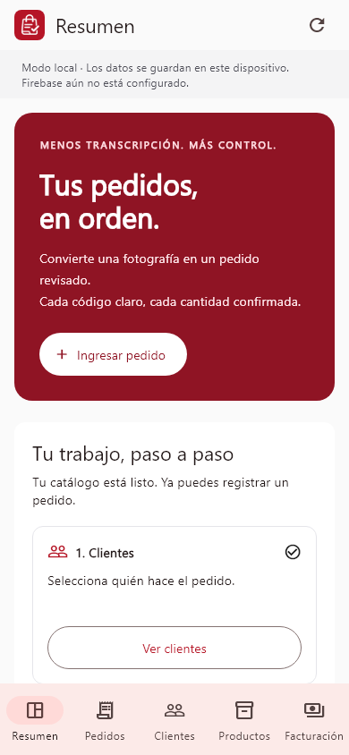
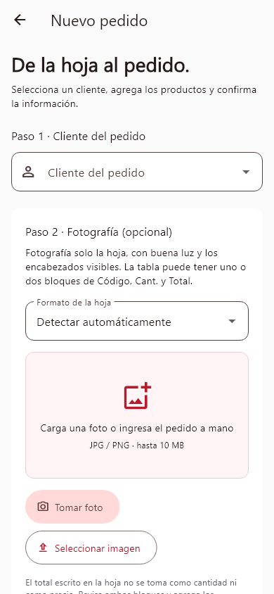
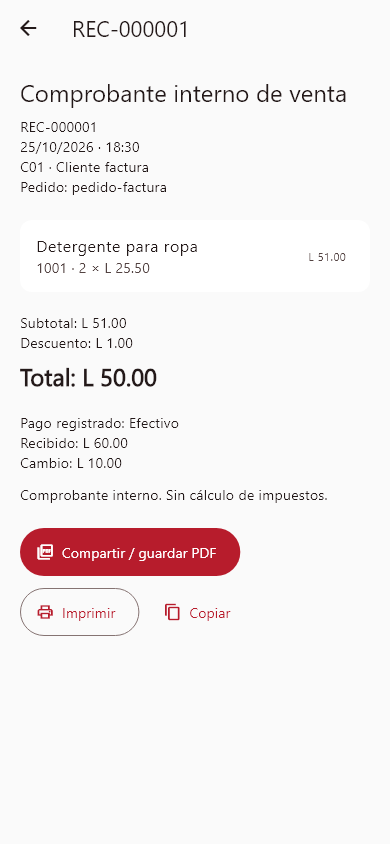
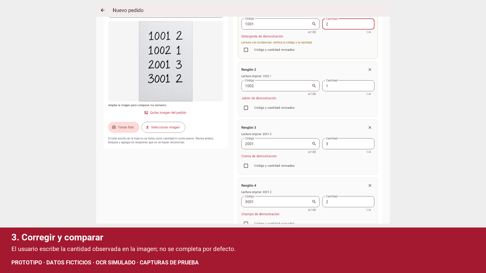

<p align="center"></p>

# Sistema de Ingreso de Pedidos

Aplicación Flutter en español para pasar de una hoja de pedido a un pedido revisado y un comprobante interno. Incluye catálogo, clientes, lectura de fotografías en Android y registro de pagos en lempiras.

**Estado:** prototipo para evaluación y portafolio. **Autor:** [Javier David Ortega Herrera](https://github.com/javierdavidortegaherrera-ui), estudiante de Ingeniería en Informática en CEUTEC, Honduras.

## Vista de la aplicación

Las capturas usan datos ficticios y fueron generadas con pruebas de widgets.

| Resumen | Ingreso de pedido | Comprobante |
|---|---|---|
|  |  |  |

## Demostración

[](docs/demo/flujo-pedidos.mp4)

[Video: fotografía → revisión → pedido → comprobante](docs/demo/flujo-pedidos.mp4). Muestra la interfaz mediante capturas secuenciales de una prueba automatizada, con datos ficticios y **respuesta OCR simulada**. No mide reconocimiento manuscrito ni representa una grabación de un teléfono. [Cómo reproducirlo](docs/demo/README.md).

## Funciones

- Clientes y productos: alta, edición, búsqueda y desactivación confirmada.
- Pedido manual, varios renglones o fotografía desde cámara/galería Android.
- Búsqueda por código o nombre; códigos conservados como texto, incluidos ceros iniciales.
- Interpretación de pares código/cantidad y tablas de uno o dos bloques con encabezados Código, Cantidad y Total.
- Comparación con imagen ampliable, alertas y revisión explícita por renglón antes de guardar.
- Historial, detalle y estados Registrado, Preparando, Entregado y Cancelado.
- Comprobantes internos en HNL: precios en centavos, descuento y conservación de precios emitidos.
- Efectivo con cambio, tarjeta de débito, tarjeta de crédito y transferencia; referencia para pagos distintos de efectivo.
- Exportación del comprobante a PDF para compartir o imprimir.
- Interfaz Material 3 adaptable, identidad roja y blanca y guía de configuración inicial.

## Tecnologías y organización

Flutter/Dart, Material 3, SharedPreferences, Google ML Kit, image_picker, pdf y printing. Hay adaptadores para Firebase Authentication, Firestore y Storage, opcionales y sin proyecto remoto incluido.

```text
lib/
  modelos/       Entidades y reglas de negocio
  datos/         Repositorios local y Firebase
  controladores/ Estado y operaciones
  servicios/     OCR, interpretación y PDF
  vistas/        Formularios y navegación
test/            Pruebas de lógica y widgets
test/firebase/   Pruebas de reglas en emulador
docs/            Arquitectura, capturas, video y entrega
scripts/         Auditoría, licencias y preparación del APK
```

Consulta [arquitectura y decisiones](docs/ARQUITECTURA.md).

## Instalación y ejecución

Probado con **Flutter 3.47.8 estable y Dart 3.13.7**. Para Android necesitas SDK/JDK compatibles y Android 7.0/API 24 o superior. Abre la carpeta del proyecto en VS Code y, desde su terminal:

```powershell
flutter pub get
flutter devices
flutter run -d ID_DEL_DISPOSITIVO
```

En el teléfono habilita depuración USB y acepta la autorización del equipo. Para probar la interfaz en navegador:

```powershell
flutter run -d chrome
```

El modo local no requiere cuenta ni Firebase. En un espacio vacío puedes cargar datos de ejemplo desde el resumen. Antes del primer pedido debe existir al menos un cliente y un producto activos. En web la fotografía sirve de referencia y la transcripción es manual; el OCR está implementado para Android.

Ejemplo de renglones con códigos existentes en tu catálogo:

```text
1001 2
1002 x 1
2001;3
```

## Almacenamiento y límites actuales

- El modo predeterminado almacena datos **localmente con SharedPreferences**. Desinstalar o borrar datos puede eliminarlos; no hay respaldo en la nube ni restauración automática configurados.
- Firebase requiere configuración propia y validación de extremo a extremo. No se incluyen cuentas, claves ni datos de producción. Las reglas tienen pruebas de emulador; eso no certifica un despliegue real.
- La escritura manuscrita puede producir lecturas incompletas. No se ha medido precisión real en Android físico; la revisión humana es obligatoria.
- Hasta 100 productos distintos por pedido y cantidades enteras de 1 a 9999. Se requiere un catálogo activo; no se inventan productos a partir de una foto.
- Los precios nuevos usan lempiras. Los precios antiguos sin moneda se interpretan como USD y requieren revisión; no existe conversión automática.
- Los métodos de pago registran un pago recibido; no conectan con bancos ni procesan tarjetas. No se solicitan números de tarjeta ni CVV.
- El comprobante es interno: **no es una factura fiscal autorizada por el SAR**. No hay inventario, contabilidad ni validación fiscal completos.
- La compilación de prototipo usa firma de desarrollo y requiere otra estrategia de firma para distribución comercial.

## Firebase opcional

1. Crea tu proyecto y registra la app Android `hn.javier.sistema_ingreso_pedidos` o una app web.
2. Configura Authentication por correo/contraseña, Firestore y Storage. Cada cuenta tiene su propio catálogo, clientes y pedidos.
3. Copia `firebase.example.json` a `firebase.local.android.json` o `firebase.local.web.json` y completa las opciones de cliente correspondientes. Los archivos locales están excluidos de Git; no uses cuentas de servicio.
4. Revisa y despliega las reglas en tu proyecto antes de usarlo con datos propios.

```powershell
firebase deploy --only firestore:rules,storage --project TU_PROJECT_ID
flutter run -d ID_DEL_DISPOSITIVO --dart-define-from-file=firebase.local.android.json
```

El repositorio no apunta a ningún proyecto Firebase de producción. Si la inicialización falla se muestra el error.

## Verificación

```powershell
flutter analyze
flutter test --reporter expanded
python scripts/auditar_publicacion.py
```

Las pruebas cubren validaciones, interpretación, persistencia local, revisión, comprobantes y pagos. [Resultados y límites](docs/VERIFICACION.md). Las pruebas de Firestore se ejecutan aparte: [instrucciones](test/firebase/README.md).

## APK y publicación

El APK se entrega mediante **GitHub Releases**, separado del código. La publicación remota está pendiente de crear el repositorio; no se enlaza una descarga inexistente.

```powershell
flutter build apk --release
powershell -ExecutionPolicy Bypass -File scripts/preparar_release.ps1
```

La carpeta ignorada `dist/release/` contiene APK, SHA-256, instrucciones y licencias. [Guía para crear el repositorio y su Release](docs/PUBLICACION.md). [Notas del prototipo](docs/releases/v1.0.0-prototipo.1.md).

## Privacidad, licencia y atribuciones

Solo se incluyen datos ficticios. Los archivos locales, fotografías privadas, credenciales, bases operativas, dependencias descargadas y compilaciones están excluidos. La auditoría estática ayuda a revisar candidatos de Git; no garantiza ausencia de datos sensibles en cualquier archivo. [Política de seguridad](SECURITY.md).

Código propio bajo [MIT](LICENSE). Las dependencias y fuentes conservan sus licencias: [atribuciones](docs/ATRIBUCIONES.md) y [avisos de dependencias](docs/LICENCIAS_DEPENDENCIAS.txt). Desarrollo iterativo con asistencia de IA.
